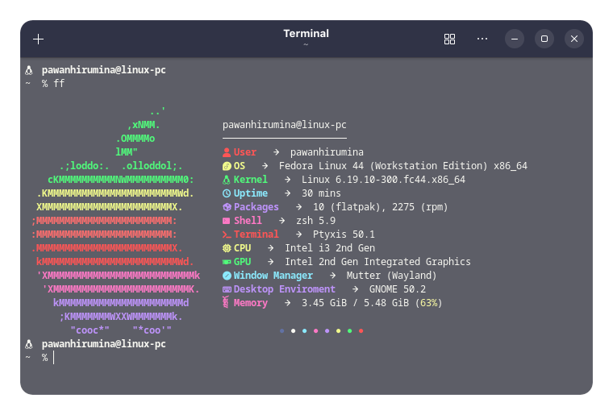
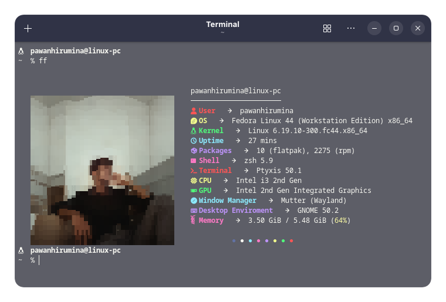
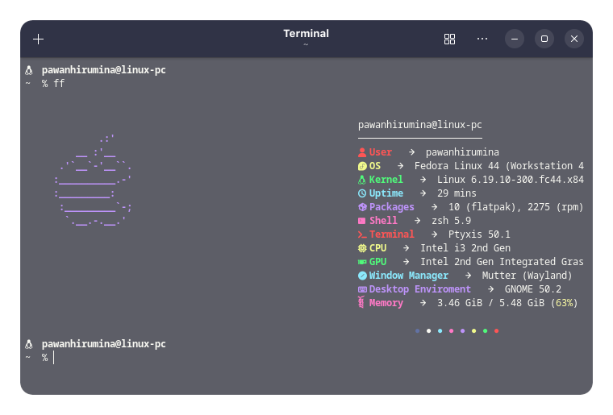

# Fastfetch & Zsh Rice

A simple Fastfetch theme and custom Zsh configuration for a clean and minimal terminal setup.

## Screenshots

### Custom OS Logo

You can use any Fastfetch logo, regardless of your current distribution.



### Custom Fastfetch Layout

Example of the included Fastfetch configuration:



### Custom ASCII Art Logo

You can also use your own ASCII art instead of a default OS logo.



## Features

### Fastfetch

* Custom Fastfetch layout
* Supports default OS logos
* Supports custom images using Chafa
* Supports custom ASCII art logos
* Easy customization

### Zsh

* Oh My Zsh integration
* Git plugin enabled
* Minimal custom prompt
* Useful aliases
* Nerd Font icons

Example prompt:

```text
  username@hostname
~/current/folder $
```

## Installation

Clone the repository:

```bash
git clone https://github.com/pawanhirumina/dot-files.git
cd dot-files
```

Make the installer executable:

```bash
chmod +x install.sh
```

Run the installer:

```bash
./install.sh
```

The installer will:

* Create required configuration directories
* Back up existing Fastfetch configuration
* Back up your current `.zshrc`
* Install the included Fastfetch theme
* Install the included Zsh configuration

After installation, restart your terminal or run:

```bash
source ~/.zshrc
```

## Requirements

### Fastfetch

Install Fastfetch using your distribution's package manager.

### Zsh

Install:

* Zsh
* Oh My Zsh

Oh My Zsh installation:

```bash
sh -c "$(curl -fsSL https://raw.githubusercontent.com/ohmyzsh/ohmyzsh/master/tools/install.sh)"
```

### Nerd Font

A Nerd Font is recommended to display icons correctly.

Popular choices:

* JetBrainsMono Nerd Font
* FiraCode Nerd Font
* Hack Nerd Font

## Fastfetch Customization

This theme is customized to my liking, but you can change it however you want.

To view available logos:

```bash
fastfetch --list-logos
```

To search for logos for a specific operating system:

```bash
fastfetch --list-logos | grep -i "arch"
```

Example configuration:

```json
"logo": {
    "type": "auto",
    "source": "fedora",
    "width": 15,
    "height": 15,
    "padding": {
        "top": 2,
        "left": 2,
        "right": 2
    }
}
```

| Type    | Description                                     |
| ------- | ----------------------------------------------- |
| `auto`  | Automatically detects and displays your OS logo |
| `file`  | Uses an ASCII art file                          |
| `chafa` | Displays an image as the logo                   |

## Using an Image as the Logo

1. Save your image somewhere on your system.
2. Copy its path.
3. Change the logo type to `chafa`.
4. Set the image path as the source.

Example:

```json
"logo": {
    "type": "chafa",
    "source": "~/Pictures/my-logo.png",
    "width": 15,
    "height": 15,
    "padding": {
        "top": 2,
        "left": 2,
        "right": 2
    }
}
```

Adjust the width and height values until the image fits your terminal nicely.

## Using ASCII Art as the Logo

1. Save your ASCII art in a text file.
2. Change the logo type to `file`.
3. Set the file path as the source.

Example:

```json
"logo": {
    "type": "file",
    "source": "~/Documents/my-logo.txt",
    "width": 15,
    "height": 15,
    "padding": {
        "top": 2,
        "left": 2,
        "right": 2
    }
}
```

## Included Zsh Configuration

The included `.zshrc` uses:

```zsh
plugins=(git)
```

Aliases:

```zsh
alias cl="clear"
alias py="python3"
alias ls="ls -a"
alias ff="fastfetch"
```

### Prompt Shortcuts

| Variable    | Description                     |
| ----------- | ------------------------------- |
| `%n`        | Username                        |
| `%m`        | Hostname                        |
| `%d`        | Current path                    |
| `%~`        | Current directory               |
| `%c`        | Current folder only             |
| `%#`        | User prompt symbol (`$` or `#`) |
| `%F{color}` | Set text color                  |
| `%f`        | Reset color                     |
| `%t`        | Current time                    |
| `%w`        | Current date                    |
| `%B`        | Bold text                       |
| `%I`        | Command line number             |

### Current Prompt

```zsh
PROMPT='%B%F{white}  %n@%m %b
 %~  %# %f'
```

### Nerd Font Icons

| Icon | Description |
| ---- | ----------- |
|     | Linux       |
|     | macOS       |
|     | Fedora      |
|     | Windows     |
|     | Arch Linux  |

## Screenshots

Add your screenshots here:

```text
src/fastfetch_custom_logo.png
src/fastfetch_ss.png
src/ascii_art.png
```

## License

Feel free to modify and use this configuration however you like.
